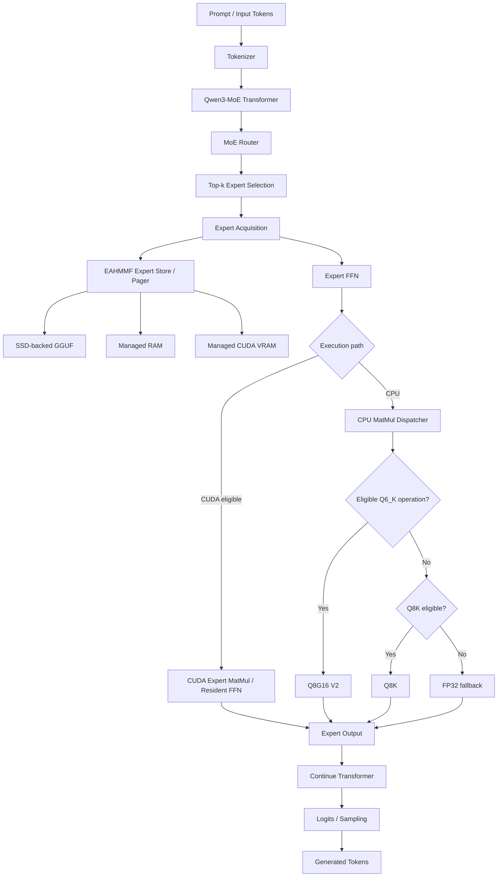
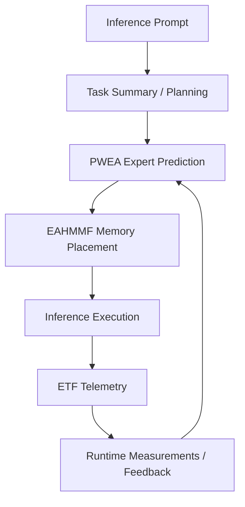

# EAHMMF Inference Engine

**A research-oriented C++17 inference engine for Qwen3-MoE GGUF models, combining expert-aware hierarchical memory management, CUDA-assisted expert computation, and optimized quantized CPU matrix multiplication.**

## Project status

- **Development line:** `v1.1.0` (proposed)
- **Status:** Release-candidate documentation; final regression and release checks remain.
- **Predecessor:** [EAHMMF Inference Prototype v0.1.0](https://github.com/jonny14-bro/EAHMMF_inference_prototype_V-0.1.0)

This repository is the next engineering stage after the original prototype. Both repositories remain separate milestones so their development and research history can be examined independently.

## Overview

EAHMMF is an experimental Qwen3-MoE GGUF inference engine. It combines:

1. **Inference and expert execution:** GGUF loading, tokenization, transformer execution, MoE routing, CPU matrix multiplication, and CUDA-assisted expert computation.
2. **Expert-aware memory management:** staging expert weights across SSD-backed GGUF storage, managed host RAM, and CUDA VRAM.

The model router selects experts. EAHMMF manages the residency and movement of selected expert weights; it does not replace or modify model routing.

### Main capabilities

- Qwen3-MoE GGUF model loading and inference.
- MoE routing, top-k expert selection, and expert feed-forward execution.
- Expert residency management across SSD, RAM, and VRAM.
- Transactional expert migration, leases, pinning, eviction, and residency accounting.
- CUDA-assisted expert matrix multiplication and an optional GPU-resident expert FFN path for supported formats.
- Q8G16 V2 SIMD activation quantization and AVX-VNNI dot-product execution for eligible Q6_K CPU operations.
- Q8K as a secondary optimized CPU path.
- Original FP32 dequantization and matrix multiplication fallback.
- Replay-based numerical and performance experiments, runtime smoke tests, and memory-management validation.
- Research integration points for EAHMMF, PWEA, and ETF.

## Architecture

### Inference and expert execution



### Hierarchical expert memory

| Tier | Role |
|---|---|
| **SSD** | Immutable, memory-mapped GGUF backing |
| **RAM** | Managed host-memory copies of expert weights |
| **VRAM** | Managed CUDA device-memory copies of expert weights |

The expert store tracks descriptors, residency, byte accounting, validity, and pin counts. The pager performs staging, migration, and reclamation. Move-only expert leases protect weights while they are in use.

Migration is staged transactionally: allocate the destination, copy and synchronize as required, validate when enabled, publish the new residency, and then release the old copy. A failed migration frees the partial destination and preserves the previous valid copy.

### CPU Q6_K dispatch

For eligible Q6_K CPU matrix multiplications, the dispatcher prefers:

1. **Q8G16 V2** — checked activation quantization, AVX2 SIMD quantization, and AVX-VNNI dot-product execution.
2. **Q8K** — secondary optimized path when eligible.
3. **FP32** — conservative original dequantization and dot-product fallback.

Both current Q8G16 and Q8K dot-product implementations require AVX-VNNI. Q8G16 uses AVX2 for activation quantization. CPUs without AVX-VNNI use the FP32 path; Q8K is not a universal non-VNNI fallback.

Checked Q8G16 quantization rejects invalid activation blocks. When validation fails, the dispatcher uses the FP32 fallback rather than forcing an unsupported optimized path.

### CUDA execution boundary

CUDA expert computation supports Q8_0, Q4_K, Q5_K, and Q6_K. The optional `--cuda-resident-ffn` path keeps supported expert FFN intermediates on the GPU, but the complete transformer is **not** GPU-resident. Attention, routing, expert selection, aggregation, and other operations remain host-side in the documented implementation.

Actual expert residency and execution depend on runtime configuration, memory availability, tensor support, and runtime state. CUDA support does not mean every model operation executes on the GPU or every expert remains permanently resident in VRAM.

## EAHMMF, PWEA, and ETF

The intended research workflow connects task understanding, expert-demand prediction, memory placement, inference, and telemetry:



- **EAHMMF — Expert-Aware Hierarchical Memory Management Framework:** manages expert placement across memory tiers.
- **PWEA:** the prediction-related component used in the expert-placement research workflow.
- **ETF — Expert Telemetry Framework:** collects expert activation and runtime observations for analysis and feedback.

These components and the CPU kernel dispatcher are related but distinct subsystems. Some documented CPU dispatch smoke tests ran with ETF collection disabled and prediction disabled. Those tests validate CPU dispatch and inference, not the complete prompt-to-prediction-to-placement-to-telemetry feedback loop.

## Selected experimental results

These are local research results tied to the stated workloads and environments, not independently reproduced third-party benchmarks.

### Q8G16 V2 replay comparison

The checked replay benchmark compared Q8K with checked Q8G16 V2 + SIMD over captured activation/weight records.

| Metric | Q8K | Q8G16 V2 + SIMD |
|---|---:|---:|
| Sum of per-record medians | 4.950583 ms | 3.937160 ms |
| Median per-run aggregate | 5.007642 ms | 4.001904 ms |

**Measured improvement:** 20.47% using the sum of per-record medians and 20.08% using the median per-run aggregate.

Conditions: 8 threads, 2 warmups, 7 trials, repeated runs. These are replay measurements, **not end-to-end inference latency or full-model tokens-per-second improvements**.

Across six replay records, Q8G16 reduced activation NRMSE by approximately 51–70% relative to Q8K for the listed operations. Scalar and AVX2 SIMD Q8G16 quantization produced zero byte mismatches across 1,224 tested activation blocks. These results apply to the tested records only.

### Q6 central validation — 20 November 2026

| Measurement | Result |
|---|---:|
| Tests | 9 |
| Passed | 9 |
| Failed | 0 |
| Skipped | 0 |
| Recorded duration | 380.144 ms |

The full-mode suite covered the integrated Q6 kernel, checked Q8G16 quantization, finite and non-finite edges, subnormal edges, rounding modes, FTZ/DAZ behavior, stress validation, and rounding diagnostics.

Recorded environment: Intel Core i5-13450HX, GCC 16.2.1, C++17, Linux kernel `7.2.11-200.fc44.x86_64`.

### Real-workload numerical error attribution — 20 November 2026

| Measurement | Result |
|---|---:|
| Captured records | 5,000 |
| Activation tokens | 13,288 |
| Output pairs analyzed | 20,712,064 |
| Threads | 8 |
| Zeroing NRMSE | 0.139392% |
| Rounding NRMSE | 0.434884% |
| Total NRMSE | 0.451601% |
| Closure maximum absolute error | 4.3791e-05 |
| Closure RMSE | 1.7344e-07 |
| Non-finite outputs | 0 |

The large weight and activation inputs are not included in the compact evidence bundle. The run manifest records the Git revision as unavailable, so this evidence documents a working-tree execution and is **not pinned to a source commit**. Repeat validation against the exact release commit before treating it as release verification.

Evidence: `benchmarks/q6_central/reports/github_evidence_20261120/`

### CUDA and memory-management validation

- **R3:** a five-round-per-policy descriptive comparison of LRU, Frequency 1024, and Frequency 4096 under one tested model and workload. Frequency 4096 had the lowest mean wall time in that experiment. This is not a general performance guarantee.
- **R4:** the tested general CUDA kernel, warp kernel, and paired gate/up path passed CPU-reference shadow validation for the recorded model and workload. The report records 129,456 comparisons and zero mismatches across four runs. An earlier R3-reported 186-mismatch discrepancy was not reproduced; its original cause remains unexplained.

See `benchmarks/r3_20261111/` and `benchmarks/r4_20261111/` for the reports and retained evidence.

## Build

### Requirements

- Linux
- GNU Make
- G++ with C++17 and OpenMP
- NVIDIA CUDA Toolkit and an NVCC-compatible host compiler for CUDA builds
- Python, NumPy, `gguf`, and `regex` for Python-based tests and validation

### CPU build

```bash
make clean
make -j"$(nproc)"
```

### CUDA build

```bash
make clean
make CUDA=1 -j1
```

Run `make clean` when switching between CPU-only and CUDA configurations.

## Run

One-shot inference:

```bash
./qwen3moe -m /path/to/model.gguf \
  -p "Explain mixture of experts." \
  -n 128 -c 8192 -t 8
```

CUDA expert computation:

```bash
./qwen3moe -m /path/to/model.gguf \
  --device cuda --expert-tier vram --cuda-compute \
  -p "Explain transformers."
```

Optional GPU-resident expert FFN (for supported formats):

```bash
./qwen3moe -m /path/to/model.gguf \
  --device cuda --expert-tier vram \
  --cuda-compute --cuda-resident-ffn \
  -p "Explain transformers."
```

Use the executable's help output and the detailed technical documentation for the complete CLI option list and configuration controls.

## Validation

Install Python test dependencies in an isolated environment:

```bash
python3 -m venv .venv
source .venv/bin/activate
python -m pip install -r requirements-test.txt
```

Run standard project checks:

```bash
make check
```

For CUDA-enabled verification:

```bash
make clean
make CUDA=1 -j1
make CUDA=1 check
```

The repository includes tiny-model numerical tests, pre-tokenizer tests, baseline comparisons, C++ EAHMMF residency and invariant tests, CUDA correctness tests, and benchmark-specific validation scripts. Some research and replay tests require locally held models or datasets and are not expected to run from a clean clone without those inputs.

## Documentation and evidence

- `README_EAHMMF_v1.1.0.md` — detailed v1.1.0 architecture, implementation, benchmark, runtime, and release-candidate documentation.
- `benchmarks/q6_central/REAL_WORKLOAD_BENCHMARK.md` — real-workload benchmark usage and modes.
- `benchmarks/q6_central/reports/github_evidence_20261120/` — compact Q6 validation evidence.
- `benchmarks/r3_20261111/` — expert-residency policy benchmark report and evidence.
- `benchmarks/r4_20261111/` — CUDA correctness report and evidence.
- `pwea/reports/progress_20261115/` — PWEA / EAHMMF research progress report.

## Public evidence availability

The repository distinguishes published research summaries from the complete
local experiment records used to produce them.

- **Q6:** The compact evidence bundle includes the central validation report,
  real-workload manifest, and aggregate attribution results. Large weight and
  activation inputs are withheld. The recorded run has no available Git
  revision, so it documents a working-tree execution rather than a
  commit-pinned release test.
- **R3:** The benchmark report and sanitized aggregate `results_public.jsonl` are designated
  research materials. The original checksum manifest is not part of the
  published research evidence. The original raw results file is withheld
  because it contains local paths and full command lines. The sanitized
  `results_public.jsonl` retains all 19 records and their benchmark metrics.
  The original checksum manifest references local trial logs, environment
  records, a compiled executable, and implementation files. Its historical
  local verification must not be interpreted as verification of the public
  bundle.
- **R4:** The correctness report is designated research material. The
  original and paired-repeat checksum manifests and their underlying raw
  execution logs are not included in the published research evidence. The
  report records the historical local checksum verification; those checks
  cannot be independently repeated from the compact public evidence alone.
- **PWEA:** The sanitized aggregate LOCO evaluation JSON and designated active
  evaluation prompt suites are published. Raw activation sessions,
  per-session evaluation records, private source identifiers, and original
  session-level checksum manifests are withheld. The aggregate results
  evaluate expert-ranking quality; they do not establish actual memory
  placement or inference-latency improvement.

The reports preserve their recorded experimental results and limitations.
Omitted raw artifacts are not represented as publicly available or as
independently reproducible from this repository. Source implementation,
including benchmark runners, remains subject to `LICENSE-CODE`; inclusion
of a research report does not relicense its supporting software.

## Current limitations

1. The loader targets Qwen3-MoE GGUF rather than arbitrary transformer architectures.
2. GGUF versions 2 and 3 are supported; nested metadata arrays are unsupported.
3. The tokenizer expects GPT-2 tokenizer data and uses the Qwen2-style pre-tokenizer.
4. RoPE scaling other than `none` is not implemented.
5. CUDA expert computation supports Q8_0, Q4_K, Q5_K, and Q6_K only.
6. The complete transformer is not GPU-resident.
7. Expert migration is synchronous; asynchronous prefetch and copy/compute overlap are not implemented.
8. The current Q8G16 and Q8K dot-product paths require AVX-VNNI.
9. Learned expert prediction and predictive prefetch are not yet established as a complete end-to-end runtime control loop.
10. The cited experiments are workload- and hardware-specific; they do not establish universal performance improvements or generalization to all MoE models.

## Licensing and contributions

This repository is intended to be publicly viewable for research discussion and collaboration.

- **Source implementation:** proprietary; all rights reserved. Public visibility does not grant permission to copy, modify, redistribute, or commercially exploit the source code.
- **Research materials:** only files explicitly listed in `RESEARCH-LICENSE-SCOPE.md` are licensed separately under CC BY 4.0. This includes designated research reports, evaluation prompts, manifests, and aggregate evidence. The research license does not apply to source code, model weights, raw datasets, or third-party materials unless expressly stated.
- **Contributions:** collaboration is welcome through reviewed and approved contributions. Please discuss proposed changes before investing substantial work; contribution terms must be agreed before a contribution is accepted.

Third-party code, models, datasets, and other materials remain subject to their own licenses and terms. This repository should not be treated as an open-source software release.

## Acknowledgements and lineage

This project continues the work documented in the original [EAHMMF Inference Prototype v0.1.0](https://github.com/jonny14-bro/EAHMMF_inference_prototype_V-0.1.0). The prototype and this inference-engine development line remain independently available so readers can inspect the research and engineering evolution.

Benchmark results are tied to their stated test setups. Reproduce them against the exact source revision and inputs before using them for external performance claims.
